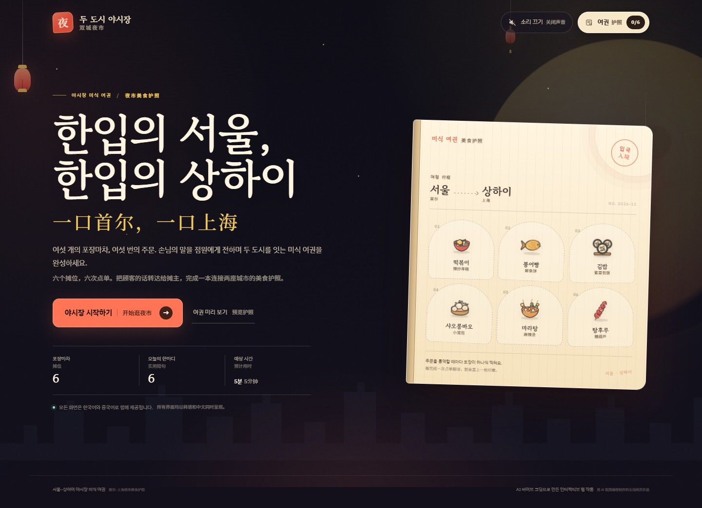
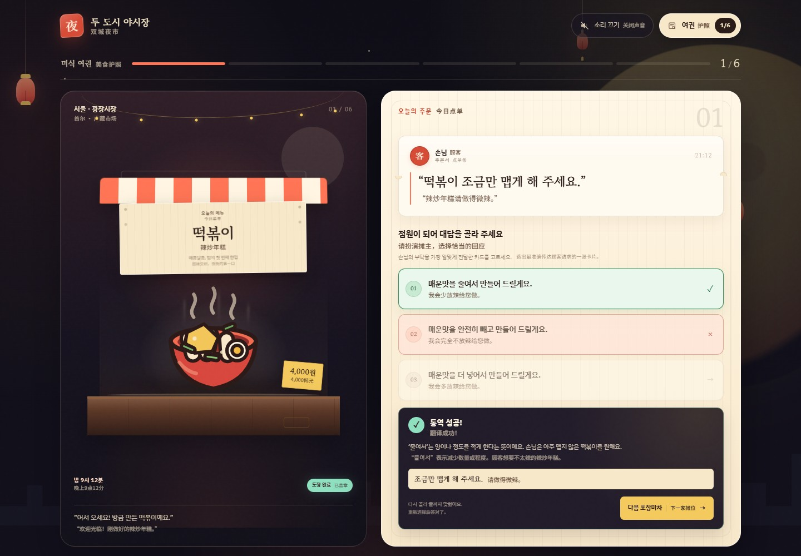
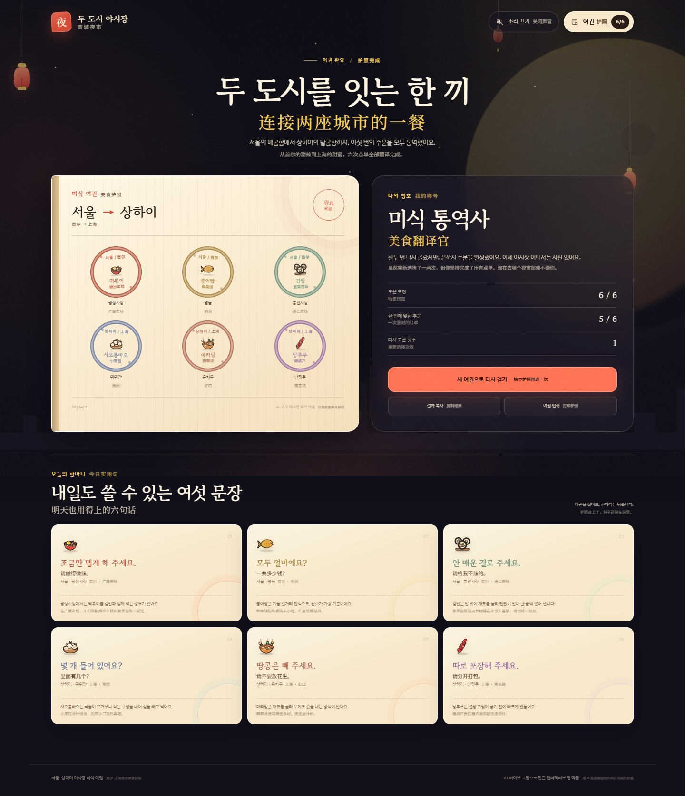
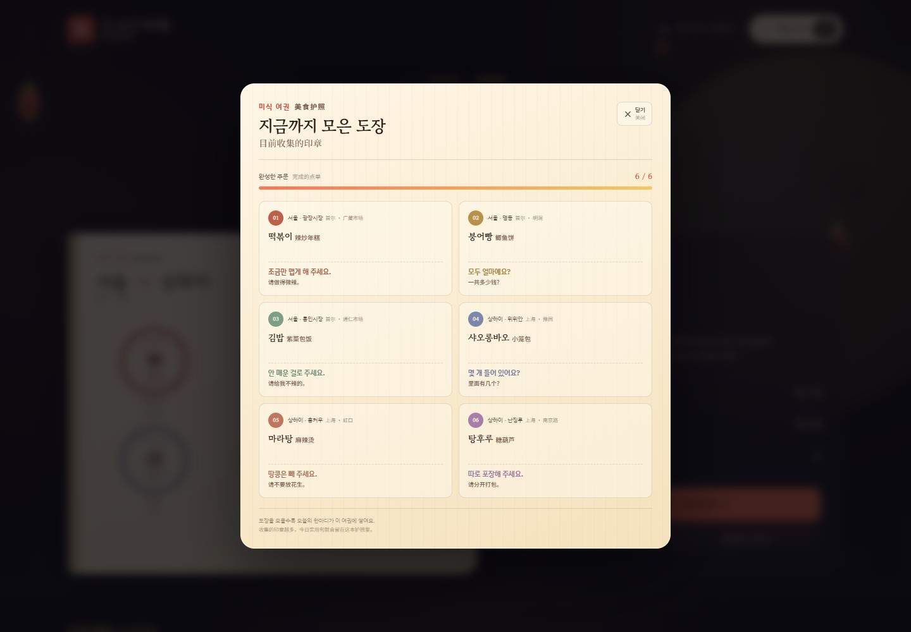
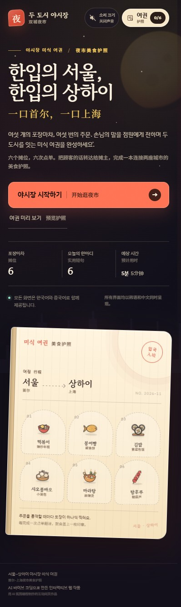

<div align="center">

# 두 도시 야시장 · 双城夜市

### 한입의 서울, 한입의 상하이
### 一口首尔，一口上海

서울과 상하이의 야시장을 걸으며 주문을 통역하고, 미식 여권에 도장을 모으는 한·중 이중언어 인터랙티브 웹 게임입니다.

在首尔与上海的夜市之间穿梭，翻译点单、收集美食护照印章的韩中双语互动网页游戏。

**HTML · CSS · JavaScript · No build · No external runtime library**

**데모 / 在线体验:** https://wsnd0927-wq.github.io/two-city-night-market/  
**저장소 / 仓库:** https://github.com/wsnd0927-wq/two-city-night-market



</div>

---

## 1. 작품 소개 / 作品简介

| 한국어 | 中文 |
| --- | --- |
| **제목:** 두 도시 야시장 — 서울–상하이 미식 여권 | **标题：** 双城夜市 — 首尔–上海美食护照 |
| **장르:** 인터랙티브 웹 게임 / 언어 학습 | **类型：** 互动网页游戏 / 语言学习 |
| **목적:** 한국어와 중국어로 된 실제 야시장 주문 표현을 읽고, 상황에 맞는 응답을 고르며 두 언어를 함께 익힙니다. | **目的：** 阅读真实夜市点单场景中的韩语和中文表达，选择符合情境的回答，同时学习两种语言。 |
| **플레이 시간:** 약 5분 | **游玩时间：** 约 5 分钟 |
| **대상:** 한국어·중국어 초급–중급 학습자, 두 도시의 음식 문화에 관심 있는 사람 | **对象：** 韩语、中文初中级学习者，以及对两座城市饮食文化感兴趣的人 |

**한국어.** 여섯 개의 포장마차가 서울과 상하이에 하나씩 펼쳐집니다. 손님이 남긴 주문서를 읽고, 점원이 되어 가장 알맞은 대답을 고르세요. 주문을 통역할 때마다 미식 여권에 도장이 하나씩 찍히고, 마지막에는 두 도시를 잇는 나만의 미식 여권과 여섯 문장의 실용 표현이 남습니다.

**中文。** 六个摊位依次出现在首尔与上海。阅读顾客留下的点单条，扮演摊主选出最恰当的回答。每完成一次点单翻译，美食护照上就会盖下一枚印章；最后你会得到一本连接两座城市的美食护照，以及六句实用表达。

---

## 2. 주요 기능 / 主要功能

| 한국어 | 中文 |
| --- | --- |
| **6개의 이중언어 주문 챌린지** — 서울 3곳, 상하이 3곳의 음식과 상황이 이어집니다. | **6 个双语点单挑战** — 串联首尔 3 处与上海 3 处的美食与情境。 |
| **즉각적인 이중언어 피드백** — 정답·오답, 설명, 오늘의 한마디를 한국어와 중국어로 함께 보여 줍니다. | **即时双语反馈** — 正确答案、解析和今日一句均以韩语和中文同时呈现。 |
| **미식 여권 수집** — 완료한 주문이 도장과 실용 표현으로 여권에 쌓입니다. | **美食护照收集** — 完成的点单会以印章和实用句的形式留在护照中。 |
| **진행 상황 저장** — `localStorage`에 진행 상황과 소리 설정을 저장해, 새로고침 후에도 이어서 할 수 있습니다. | **进度保存** — 使用 `localStorage` 保存进度与声音设置，刷新后仍可继续。 |
| **결과 카드** — 칭호, 첫 시도 정답 수, 재선택 횟수, 여섯 문장을 확인하고 복사하거나 인쇄할 수 있습니다. | **结果页** — 查看称号、一次答对数量、重新选择次数与六句话，并可复制或打印。 |
| **반응형 디자인** — 데스크톱, 태블릿, 모바일에서 같은 이야기를 즐길 수 있습니다. | **响应式设计** — 桌面、平板和手机都能体验同一段故事。 |
| **접근성** — 시맨틱 마크업, 키보드 조작, 포커스 관리, `prefers-reduced-motion`을 지원합니다. | **无障碍** — 支持语义化标记、键盘操作、焦点管理与 `prefers-reduced-motion`。 |
| **Web Audio 사운드** — 외부 음원 없이 짧은 효과음을 만들고 켜고 끌 수 있습니다. | **Web Audio 音效** — 不依赖外部音频文件，生成可开关的短音效。 |

---

## 3. 실행 방법 / 运行方法

### 3.1 가장 빠른 방법 / 最快方式

`index.html`을 최신 브라우저(Edge, Chrome, Safari, Firefox)에서 바로 열어도 실행됩니다. 별도 설치나 빌드가 필요하지 않습니다.

直接用最新版浏览器（Edge、Chrome、Safari、Firefox）打开 `index.html` 即可，无需安装或构建。

### 3.2 로컬 서버로 실행 / 使用本地服务器运行

저장소 폴더에서 아래 명령을 실행합니다. 在仓库目录中运行：

```bash
# Python 3
python -m http.server 4173
```

그다음 브라우저에서 **http://localhost:4173** 을 엽니다. 然后打开 **http://localhost:4173**。

> Windows에서 `python` 명령이 없다면 `py -m http.server 4173`을 사용하세요.  
> 如果 Windows 上没有 `python` 命令，请使用 `py -m http.server 4173`。

### 3.3 GitHub Pages / GitHub Pages 部署

1. GitHub 저장소의 **Settings → Pages**로 이동합니다. / 进入仓库的 **Settings → Pages**。
2. **Source**를 `Deploy from a branch`로 선택합니다. / 选择 `Deploy from a branch`。
3. Branch를 `main`, 폴더를 `/ (root)`로 저장합니다. / 分支选择 `main`，目录选择 `/ (root)` 并保存。
4. 잠시 후 `https://wsnd0927-wq.github.io/two-city-night-market/`에서 확인합니다. / 稍后访问 `https://wsnd0927-wq.github.io/two-city-night-market/`。

모든 경로가 상대 경로라서 별도 서버 설정 없이 정적 호스팅에서 동작합니다.  
所有路径均为相对路径，可直接用于静态托管。

---

## 4. 게임 방법 / 玩法

| 단계 | 한국어 | 中文 |
| --- | --- | --- |
| 1 | **야시장 시작하기**를 누릅니다. | 点击 **开始逛夜市**。 |
| 2 | 손님의 주문서를 한국어와 중국어로 읽습니다. | 阅读顾客点单条的韩语和中文。 |
| 3 | 세 장의 응답 카드 중 알맞은 대답을 고릅니다. | 从三张回应卡片中选择最合适的一张。 |
| 4 | 피드백과 오늘의 한마디를 확인하고 다음 포장마차로 이동합니다. | 查看反馈和今日一句，前往下一个摊位。 |
| 5 | 여섯 개의 도장을 모두 모으면 미식 여권이 완성됩니다. | 集齐六枚印章后，美食护照就完成了。 |

- **키보드:** `1`–`3`으로 응답 카드 선택, `Esc`로 여권 닫기 / **键盘：** `1`–`3` 选择卡片，`Esc` 关闭护照。
- **모바일:** 카드를 탭하고 아래로 스크롤합니다. / **手机：** 点按卡片并向下滚动。
- **힌트:** 한 번 틀리면 힌트 버튼이 나타납니다. / **提示：** 答错一次后会出现提示按钮。

---

## 5. 화면 / 界面

### 야시장 주문 화면 / 夜市点单界面



### 완성된 미식 여권 / 完成的美食护照



### 여권 모아 보기 / 护照收集面板



### 모바일 / 手机



---

## 6. 기술 스택 / 技术栈

| 구분 | 내용 |
| --- | --- |
| **마크업 / 标记** | HTML5 (semantic landmarks, `dialog`, ARIA) |
| **스타일 / 样式** | Vanilla CSS (custom properties, grid, `color-mix`, responsive, print, reduced motion) |
| **동작 / 交互** | Vanilla JavaScript (ES6+, no framework, no build step) |
| **상태 저장 / 状态** | Web Storage API (`localStorage`, versioned key) |
| **사운드 / 音效** | Web Audio API oscillators (no audio files) |
| **이미지 / 图像** | Original inline/local SVG food illustrations |
| **글꼴 / 字体** | Google Fonts: Gowun Batang, IBM Plex Sans KR, Noto Sans SC, Noto Serif SC (system fallback included) |

---

## 7. 파일 구조 / 文件结构

```text
two-city-night-market/
├─ index.html                 # 앱 마크업 / 应用标记
├─ styles.css                 # 전체 디자인과 반응형 스타일 / 设计与响应式样式
├─ js/
│  ├─ data.js                 # 6개 주문, 선택지, 해설, 표현 데이터 / 数据
│  └─ app.js                  # 게임 상태, 렌더링, 접근성, 사운드 / 游戏逻辑
├─ assets/
│  ├─ tteokbokki.svg          # 직접 그린 음식 일러스트 / 原创食物插画
│  ├─ bungeoppang.svg
│  ├─ gimbap.svg
│  ├─ xiaolongbao.svg
│  ├─ malatang.svg
│  ├─ tanghulu.svg
│  ├─ favicon.svg
│  └─ screenshot-*.jpg        # README 캡처 / README 截图
├─ README.md
├─ LICENSE
└─ .gitignore
```

---

## 8. 이중언어 구현 원칙 / 双语实现原则

화면에 보이는 주요 텍스트 — 제목, 메뉴, 버튼, 주문, 입력 안내, 결과, 오류·상태 메시지 — 는 **한국어와 중국어를 동시에** 표시합니다. 소스 코드의 변수명과 실행 명령은 번역하지 않았습니다.

所有用户可见的主要文本——标题、菜单、按钮、点单、输入提示、结果、错误与状态信息——均**同时提供韩语和中文**。源代码变量名和运行命令不作翻译。

| 예시 / 示例 | 한국어 | 中文 |
| --- | --- | --- |
| 시작 / 开始 | 야시장 시작하기 | 开始逛夜市 |
| 다음 / 下一步 | 다음 포장마차 | 下一家摊位 |
| 힌트 / 提示 | 힌트 보기 | 查看提示 |
| 오류 / 错误 | 복사하지 못했어요. 다시 시도해 주세요. | 复制失败，请再试一次。 |

---

## 9. 접근성 및 검증 / 无障碍与验证

- **axe-core 4.14.1** (WCAG 2 A/AA, WCAG 2.1 A/AA, best-practice) 검사 결과:  
  데스크톱·모바일 홈, 게임, 오답·정답 피드백, 결과, 여권 다이얼로그에서 **위반 0건**.  
  그라데이션 배경의 색 대비 항목 1건은 자동 판정 불가(incomplete)로 남아 수동 검토 대상입니다.  
  **axe-core 4.14.1**（WCAG 2 A/AA、WCAG 2.1 A/AA、best-practice）检查：  
  桌面与手机首页、游戏、答错/答对反馈、结果页、护照对话框均为 **0 项违规**。  
  渐变背景的 1 项颜色对比度因无法自动判定而标记为 incomplete，列为人工复核项。
- **Playwright + Microsoft Edge** 자동 테스트: 데스크톱·모바일 전체 플로우, 오답 재시도, 힌트, 키보드 선택, 진행 저장, 새로고침 복원, 6개 스탬프, 결과 복사, 320px 레이아웃 등 **53개 체크 통과**.  
  **Playwright + Microsoft Edge** 自动化测试：桌面与手机全流程、答错重试、提示、键盘选择、进度保存、刷新恢复、六枚印章、结果复制、320px 布局等 **53 项检查通过**。
- 키보드만으로 시작, 카드 선택, 다음 단계 이동, 여권 닫기가 가능합니다.  
  仅用键盘即可开始、选择卡片、进入下一步和关闭护照。
- `prefers-reduced-motion`에서 장식 애니메이션과 컨페티를 줄입니다.  
  在 `prefers-reduced-motion` 下会减少装饰动画与彩纸效果。
- 오답 카드는 비활성화되고, 정답 후 다음 버튼으로 포커스가 이동합니다.  
  答错卡片会被禁用，答对后焦点移动到下一按钮。
- 다이얼로그는 native `<dialog>`로 포커스 트랩과 `Esc` 닫기를 지원합니다.  
  对话框使用原生 `<dialog>`，支持焦点限制与 `Esc` 关闭。

---

## 10. AI 바이브 코딩 기록 / AI 氛围编程记录

- 주제 선정, 세계관, 6개 주문 시나리오, 한국어·중국어 문안, SVG 음식 일러스트, UI, 게임 로직, 테스트를 **AI 에이전트와 대화하며** 반복 제작했습니다.  
  主题、世界观、6 个点单场景、韩中文案、SVG 食物插画、界面、游戏逻辑与测试，均通过与 **AI 代理对话**迭代完成。
- 결과물은 **2026년 11월 26일**, Microsoft Edge에서 전 과정을 다시 실행해 검증했습니다.  
  交付物已于 **2026 年 11 月 26 日**在 Microsoft Edge 中重新跑通全流程并完成验证。
- 모든 코드는 저장소에 포함되어 있으며, 외부 API 키·비밀번호·개인정보를 사용하지 않습니다.  
  所有代码均包含在仓库中，不使用任何 API 密钥、密码或个人信息。
- 외부 이미지나 음원을 사용하지 않았고, 음식 일러스트와 OG 미리보기 이미지는 이 프로젝트를 위해 직접 생성했습니다.  
  未使用外部图片或音频，食物插画与 OG 预览图均为本项目直接生成。
- Google Fonts는 각 글꼴의 OFL 라이선스를 따릅니다.  
  Google Fonts 遵循各字体的 OFL 许可证。

---

## 11. 라이선스 / 许可证

코드는 [MIT License](LICENSE)로 공개합니다.  
代码以 [MIT License](LICENSE) 开源。

---

<div align="center">

**서울의 밤과 상하이의 밤을, 한입씩.**
**一口首尔，一口上海。**

</div>
